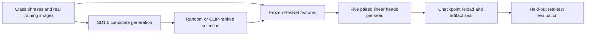

# When Does Synthetic Data Help? A Generation–Training–Evaluation Toolkit for 20-Shot Image Classification

> Working report: G3 and G4 model evaluation are complete; official predictions and run records are released. C's independent statistical analysis, four figures and result tables are complete and accepted. The first 100-image annotation form is received; the second form, non-author trial, named contributions and final report/slides integration remain outstanding. This file is the report source, not an additional execution protocol; the governing protocol is [agent.md](../agent.md), with executable settings in [study.json](../configs/study.json).

## Abstract

We develop a command-line toolkit for a practical decision: whether adding generated images improves a classifier when real training labels are scarce. The toolkit generates class-conditioned candidates, selects equal-sized random or CLIP-ranked subsets, caches features from a frozen ImageNet ResNet-18, trains paired linear classifiers, and seals their artifacts before real-test evaluation. Our case study uses CIFAR-10 with 20 real images per class, 0/50/150 retained synthetic images per class and three paired seeds. Source-balanced losses, equal optimizer updates and deterministic selection make the comparisons traceable. Mean real-test accuracy increased from 71.44% for the real-only baseline to 75.06–75.28% with synthetic augmentation, a paired gain of 3.62–3.84 percentage points across three seeds. CLIP selection added only about 0.20 points over random selection, while retaining 150 rather than 50 images per class gave essentially no mean benefit. A separate CLIP zero-shot reference scored 88.21%. The toolkit supports a conditional augmentation decision; this case does not establish superiority over alternative pretrained classifiers.

## 1. Problem, intended users and scope

The intended users are students and prototype developers who already possess a small labelled image set and need to decide whether spending compute on text-to-image generation is useful. Their immediate output should be a reproducible comparison against a real-only baseline, including reusable classifier files and measured cost. A visually convincing gallery alone cannot establish that the classifier benefits.

The application investigates three questions within one fixed setting: whether generated additions help; whether retaining 150 rather than 50 images per class changes performance; and whether CLIP ranking improves over random selection at equal retained counts. CIFAR-10 provides a controlled simulation of label scarcity. It does not establish demand in a particular industry, prove real annotation-cost savings, or cover other label budgets. Third-party needs validation and a non-author reproduction trial have not yet been completed.

## 2. Related work and contribution

Generative augmentation for recognition already has substantial precedent. He et al. investigate generated images for data-scarce recognition and transfer learning, including CLIP-confidence filtering, mixed real/synthetic training and frozen BatchNorm. These are established ingredients. Our contribution is the traceable implementation and controlled fixed-budget case, using an ImageNet ResNet-18 feature backbone. [He et al., 2023](https://arxiv.org/html/2210.07574v2)

Azizi et al. report classification improvements on ImageNet using samples from diffusion models adapted to class-conditioned generation. Those results motivate testing downstream utility, but do not guarantee that an unchanged SD1.5 generator helps our frozen-feature, low-label CIFAR setting. [Azizi et al., 2023](https://arxiv.org/abs/2304.08466)

CLIP provides language-defined image comparisons and a zero-shot recognition route. We therefore use it both for candidate ranking and, during the final evaluation, as a direct alternative that requires no dataset-specific classifier training. Its confidence is a selection score; it is not a human correctness label. [Radford et al., 2021](https://proceedings.mlr.press/v139/radford21a.html)

Our contribution is an integrated, auditable tool and a controlled case study. It combines frozen model references, equal-size nested selections, paired classifier initialization and sampling, fixed source weights, integrity-checked caches and a model seal before test access. We make no new generative-model or state-of-the-art classification claim.

## 3. Toolkit and experimental protocol

### 3.1 Real data and split isolation

CIFAR-10 consists of 32×32 colour images in ten classes, with 50,000 official training images and 10,000 official test images. We preserve its official class mapping. Its automobile/truck taxonomy excludes pickup trucks, which matters when judging broadly worded generated classes. [Dataset source](https://www.cs.toronto.edu/~kriz/cifar.html)

For each split seed in {0,1,2}, a deterministic class-wise permutation of the official training indices supplies 20 images per class. All five conditions for that seed share those 200 real images. Formal training uses all 20 per class. During engineering verification only, the seed-0 sample is partitioned into 16 training and 4 development images per class. These development labels are part of the same 20-shot sample, and hyperparameters are fixed before inspecting development performance.

G3 extracts and deserializes only the five official training batches and class metadata, after checksum verification. Although the downloaded archive contains test bytes, the test batch is not extracted or deserialized during G3. The final evaluator is the sole entry point that accesses the official test labels.

### 3.2 Generation and retained subsets

We use frozen Stable Diffusion 1.5 weights, referenced by an exact repository revision and verified file hashes. Latent diffusion supplies the architectural background for this generator. [Rombach et al., 2022](https://arxiv.org/abs/2112.10752)

The formal pool contains 200 candidates per class, shared across all split seeds. Class prompts use a fixed phrase such as “an airplane” or “a car”, within one photo template. Sampling uses 512×512 output, 20 steps, DPM-Solver++ with solver order 2, guidance scale 6, fp16 and batches of four. Each image has its own CPU random generator. Engineering smoke images use a separate seed range. Exact model revisions, phrases and sampler flags are maintained in the configuration.

Random ranking uses a fixed within-class permutation. CLIP ranking uses the target-class probability from a softmax over all ten image–text logits, including the model's learned scale. Ties are resolved by image ID. For each method, the top 50 are contained in the top 150. Both methods retain exactly the requested number from every class.

| Condition | Retained synthetic images per class | Selection |
|---|---:|---|
| real_only | 0 | — |
| random_50 | 50 | Fixed random permutation |
| clip_50 | 50 | Target-class CLIP rank |
| random_150 | 150 | Same random permutation |
| clip_150 | 150 | Same CLIP rank |

The generator is not fine-tuned. Non-finite or genuinely black model outputs stop generation. Safety flags retain the exact pre-checker output for a hash-bound safety review; their original batches are deferred until reviewed, while unrelated batches can continue. A reviewer may retain the same output only when it is safe, with no seed substitution or screening for classification quality. The pool cannot proceed to selection or training until all required reviews are resolved.

This handling was introduced as a recorded protocol correction. The initial 0.3 run stopped after 308 accepted images when the safety checker blacked out an ordinary red car with clothed pedestrians. Replaying its original seed identified a false positive. Revision 0.4 changes that post-generation handling, preserves the failed run, and records safety decisions against exact image hashes. Sampling parameters remain unchanged; all 30 engineering-smoke image hashes match between revisions. Previously accepted images are adopted byte-for-byte into a new run with source records and configuration hashes. Failure and replay overhead must be reported separately from the final successful stage timings.

### 3.3 Frozen features and matched optimization

The backbone is an ImageNet-initialized ResNet-18. The residual architecture follows He et al.; our implementation uses the fixed torchvision ImageNet V1 weights. Backbone parameters and BatchNorm running statistics remain frozen. [He et al., 2016](https://arxiv.org/abs/1512.03385)

Each original training image contributes one weight-prescribed base view and three deterministically seeded augmented views. Augmentation uses a 224-pixel random resized crop with scale [0.7,1.0], aspect ratio [0.75,4/3], and horizontal flipping probability 0.5, followed by ImageNet normalization. We L2-normalize the 512-dimensional features. Real and synthetic images use the same view procedure. Final test images use only the base view.

Only the ten-class linear head is optimized. Let the per-source loss be the mean cross-entropy over original images, after averaging each original's four view losses. The mixed objective is

\[
L_{\mathrm{mixed}}=0.5\,L_{\mathrm{real}}+0.5\,L_{\mathrm{synthetic}}.
\]

The real-only objective is the unscaled real-source loss. Consequently, adding more synthetic originals does not automatically increase their total loss weight. All conditions use 500 SGD updates, learning rate 0.1, momentum 0.9 and weight decay 0.0001. Each update samples two originals per class, with replacement, from each source that is present. All five heads within a seed share the initial head state and real-batch schedule. Three seeds therefore produce 15 formal classifiers.

### 3.4 Reproducibility and output objects

The single CLI stages generation, selection, features, training and gated evaluation. Every image carries a class ID, prompt, seed, path and checksum. Feature cache keys bind image bytes, view settings, backbone weights, library versions and extraction source. A cache success record is written after actual freezing checks succeed. Checkpoint reuse also verifies task inputs, feature bytes, model file integrity and reloaded outputs.

Completed heads are sealed into a 15-model manifest. G3 reload-check predictions use training images and are not generalization estimates. Final evaluation requires the seal and the explicit final-evaluation command. Team sharing includes source, configuration, selected IDs, rankings, small result files and artifact hashes. Large image, feature and classifier archives are delivered as GitHub Release assets with server-verified hashes and an explicit access status. Vendor pretrained weights are referenced rather than redistributed.

## 4. Evaluation and results

**G4 evaluation and C's independent analysis are complete.** The evaluation used all 10,000 official real test images with the fifteen previously sealed heads and one CLIP zero-shot reference. The released archive contains 160,000 prediction rows in original JSON and derived CSV. Engineering validation recomputed per-run and per-class accuracy, sample standard deviations and paired differences, checked every prediction-file hash and verified identical test IDs and labels across files. The model seal, training inputs, parameters and execution sources were unchanged. Source reports and access records are in [the G4 handoff](../shared/synthetic_v2/g4/README.md).

The engineering smoke exercised all five conditions, selection nesting, split isolation, loss weighting, frozen features, checkpoint reload and cache recovery. It uses 1/2 retained synthetic images per class and one development split; its accuracies are not evidence for the formal 50/150-image experiment.

G3 has produced 2,000 candidates (200 per class), all nested random/CLIP selections, and 15 sealed heads. Three 200-image real subsets contain 598 distinct originals; the portable feature array therefore has shape [2598,4,512]. The feature extraction checks confirm frozen parameters and unchanged BatchNorm statistics. An independent archive restoration verified all 2,000 image hashes, 3,001 bundled file hashes, the feature arrays and bit-identical reload logits for all 15 heads. These establish artifact integrity, not downstream utility.

| G3 production stage | Recorded seconds |
|---|---:|
| Candidate-pool generation invocations, including source failure and recovery | 2551.31 |
| CLIP selection, including input/output verification | 39.97 |
| Frozen feature extraction and bundle preparation | 69.53 |
| All 15 CPU classification heads and reload checks | 8.42 |

The generation figure sums three recorded production invocations across the preserved failed run and the current run. It includes their loading, warm-up and deferred-batch retries. It excludes downloads, G2, diagnostic reproductions, protocol/software development, human review, idle gaps, packaging and transfer. It is neither elapsed project time nor a complete end-to-end product cost. Full receipt references and exclusions are in shared/synthetic_v2/stage_costs.json. G4 took 219.36 seconds within the evaluator and 221.52 seconds including CLI startup on A's prepared machine. Recorded test-feature extraction was 115.48 seconds, head prediction/file writing 2.54 seconds, and CLIP scoring 41.42 seconds; these are components of the evaluation, not additional charges beyond its total. Exact environment and timing records are in shared/synthetic_v2/g4/invocation.json and report.json.

We report top-1 accuracy as mean ± sample standard deviation across the three seeds. Each synthetic condition is compared with the real-only classifier of the same seed before aggregating percentage-point gains. The three-seed standard deviation is not a confidence interval. The CLIP zero-shot reference is evaluated once and is reported separately.

Costs must distinguish downloading/loading, warm-up, generation, CLIP scoring, feature extraction, head fitting and final evaluation. Report first-run and cached-run costs separately. The candidate pool and selection rankings are shared across conditions and seeds, so their costs must not be counted as independent repeated generation jobs. Per-image generation timing in batch mode is an amortized throughput measure rather than single-request latency.

The candidate audit samples ten generated candidates per class, with CLIP scores hidden. The first received form contains 100 correct, zero wrong and zero uncertain judgments, with 30 nonempty notes. Here correct means that the target class is recognizable, including images with structural defects; this is not a claim that all images are geometrically correct. Notes are optional, so their count is not an exhaustive defect rate. Original judgments and notes are preserved in [the annotation CSV](../shared/synthetic_v2/audits/human_annotations/annotator_1.csv), with source hashes and validation in [the intake record](../shared/synthetic_v2/audits/human_annotations/annotator_1_intake.json). A second annotation form has not been received, so no inter-annotator agreement is reported. Annotator A reported completing the annotation on 2026-11-16 in approximately 30 minutes; this is an approximate self-reported duration. The non-author trial remains outstanding.

### 4.1 B-side independent training-artifact review

A separate CPU implementation replayed the frozen 0.4 experiment inputs and all 15 head optimizations, without changing the sealed run. It verified the official training pixels/labels and class-wise split indices, all 3,001 indexed bundle files, and all feature ID/class mappings. The maximum replayed head-weight error was 4.77e-7 (predeclared tolerance 1e-6), and all 3,000 saved training-reference predictions agreed.

Re-extracting all 598 real images and their 2,392 views left the frozen backbone and BatchNorm state unchanged. However, the CPU features differed from the sealed CUDA features by up to 2.01e-4, exceeding the strict 1e-5 absolute threshold. This finding is retained rather than relaxing the threshold. Minimum cosine similarity was 0.99999970, and replacing the base-view features changed none of the 3,000 training-reference predictions. These observations do not establish agreement on the unseen test set. A later training-only diagnostic on the first complete seed0 batch (8 images, 32 views) reproduced the sealed CUDA features bit for bit. The CPU difference was 1.02e-4; disabling cuDNN TF32 only in that diagnostic reduced CUDA/CPU error to 7.45e-7. This supports a backend-precision explanation for that batch without changing the full B strict-threshold result or making any test-set equivalence claim. Sealed models, cached inputs and G4 predictions were unchanged. Full environment, initial failures and per-model evidence appear in [the B review](B_v04_review.md) and [shared review records](../shared/b_v04_review/README.md). The work was performed with Codex assistance and does not replace a human audit.

### 4.2 Independent C-side results and practical interpretation

| Condition | Accuracy mean ± sample SD (%) | Paired gain mean ± sample SD (pp) |
|---|---:|---:|
| Real only | 71.44 ± 0.314 | +0.000 ± 0.000 |
| Random 50 | 75.08 ± 0.737 | +3.640 ± 0.835 |
| CLIP 50 | 75.28 ± 0.763 | +3.840 ± 0.773 |
| Random 150 | 75.06 ± 0.585 | +3.617 ± 0.690 |
| CLIP 150 | 75.26 ± 0.577 | +3.820 ± 0.625 |

All four synthetic conditions improved on their matched real-only baseline in all three seeds. Direct CLIP-minus-Random mean contrasts were +0.200 pp at 50/class and +0.203 pp at 150/class; corresponding 150-minus-50 contrasts were −0.023 pp for Random and −0.020 pp for CLIP. These are descriptive comparisons across three seeds, not significance claims. Per-class gains were heterogeneous: under CLIP 50, deer gained 12.47 pp, while automobile and ship fell by 1.00 and 1.97 pp. These outcomes do not identify a causal coverage or diversity mechanism.

The separate CLIP zero-shot reference reached 88.21%, exceeding all trained heads here; it uses a different pretrained model/inference route. Selected G3 production stages and G4 evaluation sum to 48.14 minutes, with generation accounting for about 88.3%. This excludes setup, downloads, development and human work. The same 2000-image pool was used for all conditions, so changing retention does not reduce its recorded generation cost.

C submitted nine independent post-processing scripts, four CSV tables, four figures and an English analysis. A reran all nine scripts: all four CSV contents matched, and all four regenerated PNGs matched the submitted pixels exactly. Original models, configuration and formal predictions were unchanged. Full results and scope are in [C's report](C_results_evaluation.md), [tables and figures](../shared/synthetic_v2/c_evaluation/README.md), and [acceptance evidence](../shared/synthetic_v2/audits/c_pr4_acceptance.json). This review does not complete the pending human label audit or non-author trial.

## 5. Limitations and interpretation

The study covers one dataset, one real-label budget, one generator and one feature backbone. The three seeds share one synthetic pool and therefore do not measure generation-pool variability. The models contain external pretraining information; the experiment is not learning classification from 200 images without prior knowledge. Generated class labels are inferred from prompts and may be incorrect. Ranking can reduce diversity or prefer images unlike CIFAR test examples, but those mechanisms require additional evidence and must not be inferred from an accuracy difference alone.

In this fixed case, augmentation improves the matched ResNet baseline, but a stronger CLIP zero-shot alternative and the generation cost limit a broad usefulness claim. Larger retained subsets were not justified by the observed mean results. Practical recommendations outside this dataset and label budget need further evidence; user usefulness still awaits the non-author trial.

## 6. Actual contributions and completion status

The user directs work package A. Codex implemented and executed the current engineering pipeline under that authorization. B/C/D human ownership, independent verification, final report editing, presentation work and attendance must be recorded from actual contributions. No teammate is credited with code, experiments or annotations solely because a role was proposed.

The merged repository records the B-side independent CPU review submitted by GitHub account careless-Snow (with declared Codex assistance) and the C-side stored-selection and simulated-statistics audits submitted by blacksheep429. These are additional review artifacts; they did not replace the sealed training inputs/models or the completed G4 evaluation. Real names, student IDs and their mapping to team members remain to be confirmed. C's independent actual-prediction analysis, tables, figures and English report are complete and integrated through PR #4; the report states AI assistance.

This draft now incorporates verified G3/G4 records and C's analysis. Named contribution details, human-validation results, final formatting and presentation evidence remain to be supplied.
